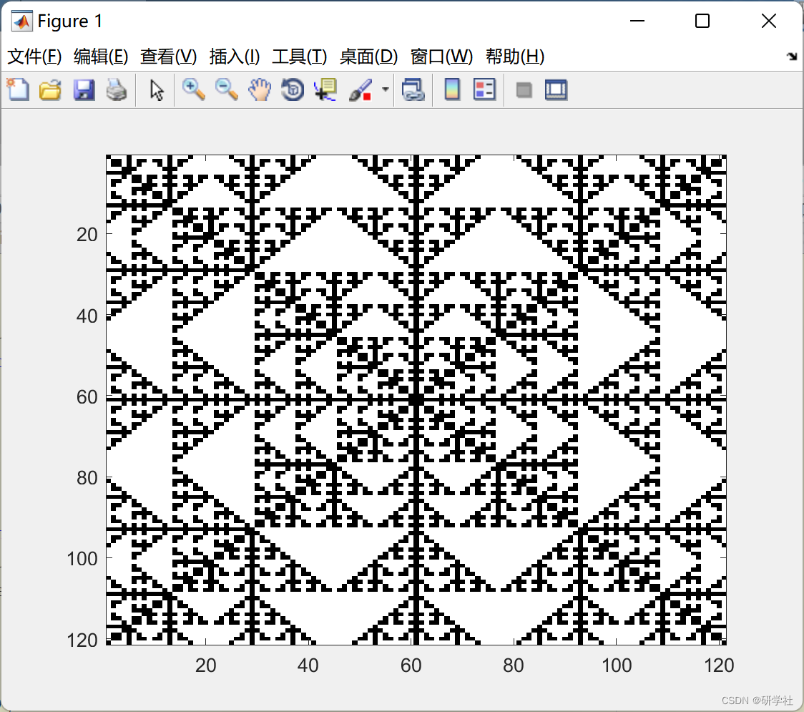

# Cellular Automaton Learning (Matlab Code Implementation)

Cellular Automaton is a grid dynamics model that discretizes time, space, and state. Each cell has a state at each moment, which can represent the individual's status and behavior on the cell. The real-world observation scene is a commercial underground parking lot, and a two-dimensional cellular automaton model is selected for modeling purposes from the dynamical models. Currently, the mainstream two-dimensional cellular automaton models mainly include three types: Von Neumann type, Moore type, and extended Moore type. Since the Von Neumann type is limited to four directions and cannot meet the simulation requirements, the extended Moore type requires higher computational demands and is suitable for more complex scenarios. For this paper's actual scenario, a cellular automaton with an Moore neighborhood is chosen for scene modeling.
📚2 Run results editing
🎉3 References
[2] Li Huang, Chen Yitao, Pan Xiaodong, Chen Feng. Research on the location selection of autonomous guided vehicles in underground parking lots based on cellular automata [J]. Transportation and Transportation, 2022, 38(04):37-42.
🌈4 MATLAB code implementation

## Images

<!-- PAYMENT_BLOCK -->

## Get this dataset

- Payment link (Stripe): [Buy now](https://buy.stripe.com/3cs8yP7sY87d0vu9AB)
- Payment QR code: 

<!-- /PAYMENT_BLOCK -->
